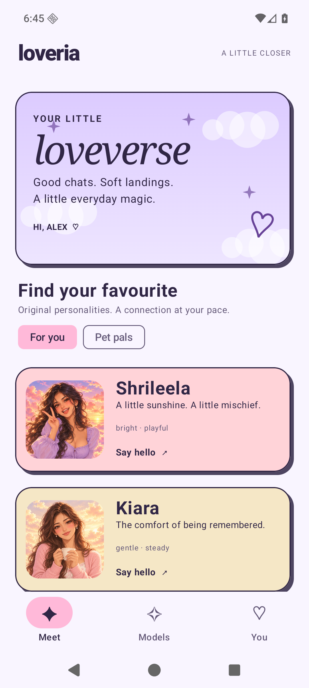
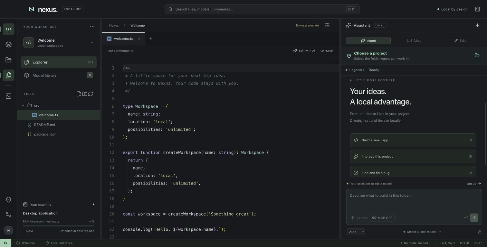

# Manthan Gopal Dhole
### Local AI · Android apps · Retrieval systems · Developer tools

I build applications that run useful AI workflows on the user's own hardware. My work includes native Android apps, source-grounded memory, offline speech, local model integration and desktop coding tools.

**Available for scoped freelance projects.** A useful first engagement is one local AI feature, one retrieval problem, or one Android workflow with clear acceptance checks.

[Discuss a project](https://github.com/MANTHAN137/applied-ai-portfolio/issues/new?template=project-brief.md) · [GitHub](https://github.com/MANTHAN137)

## Selected work

| Project | What it demonstrates | Status |
| --- | --- | --- |
| [WhatsApp chatbot](case-studies/whatsapp-chatbot.md) | Gemini integration, per-chat context, owner takeover and reply routing | Personal assistant prototype; public source |
| [Local AI Agent Orchestrator](case-studies/orchestrator.md) | Native macOS app, dependency graphs, model routing and memory admission | Working MVP; public source |
| [Pocket Memory](case-studies/pocket-memory.md) | On-device retrieval with cited source passages, local models, OCR, speech and writing tools | Android development preview |
| [Loveria](case-studies/loveria.md) | Native companion app, character-specific chat, durable memories and verified model downloads | Android 0.3 beta |
| [Nexus](case-studies/nexus.md) | Local GGUF coding workbench, project boundaries, reviewed edits and sequential agent roles | Early macOS app; public source |
| Ornith X Studio | Local model integration, draft review, scheduling, queue controls and send receipts | macOS development project |
| Jarvis | Local voice assistant, document context and a separate reviewed coding workspace | macOS development project |

### WhatsApp chatbot — context and owner takeover

A Node.js assistant connecting WhatsApp events with Gemini, bounded per-conversation history and manual or automatic pause when the owner replies. The later UltimateManthanBot project adds persisted conversation memory and utility routing. These are personal assistant prototypes using Baileys.

[Read the case study →](case-studies/whatsapp-chatbot.md) · [WhatsApp source](https://github.com/MANTHAN137/Whatsapp_agent) · [Later bot source](https://github.com/MANTHAN137/UltimateManthanBot)

### Local AI Agent Orchestrator — native macOS model workflows

A SwiftUI/AppKit control center for GGUF agents, with dependency scheduling, memory admission and observable model lifecycle. [Read the case study →](case-studies/orchestrator.md) · [Public source](https://github.com/MANTHAN137/Local-AI-Agent-Orchestrator)

### Pocket Memory — ask your own notes

Local retrieval combines SQLite keyword search with optional EmbeddingGemma vectors. Answers retain the evidence they used; unresolved linked conflicts ask for clarification. Model weights are downloaded separately. [Read the case study →](case-studies/pocket-memory.md)

### Loveria — character chat with durable memory

Nine original companion characters, local chat history, source quotations and bounded prompt construction. The beta uses lexical retrieval; it does not claim vector memory or general factual verification. [Read the case study →](case-studies/loveria.md)

### Nexus — local models inside a coding workspace

An Electron/React workbench backed by a local llama.cpp server. Includes scoped project tools, cancellation and reviewed edits. The screenshot is a browser design preview. [Public source](https://github.com/MANTHAN137/nexus-local-ide) · [Case study](case-studies/nexus.md)

## How I can help

- **Chatbot integrations:** per-conversation state, human takeover, reply routing and clear fallback behavior.
- **Local AI setup and integration:** connect a suitable local model, expose a small application workflow, and document hardware requirements.
- **Retrieval and document Q&A:** chunking, keyword/vector retrieval, source display, missing-evidence behavior and evaluation fixtures.
- **Android AI features:** Kotlin UI, SQLite persistence, model download/resume/checksums, OCR and local speech workflows.
- **Desktop AI tools:** usable interfaces, reviewed actions, task cancellation and packaging workflows.
- **Prototype repair:** investigate one reproducible bug or quality problem and deliver a focused patch with verification.

Typical starting scopes are a **$75 diagnostic** or a **$200 text-document Q&A prototype**. These are indicative quotes, not bookings: document formats, target hardware, acceptance criteria, timeline and platform fees must be agreed before work starts. A prototype is not a production deployment.

## More work and useful open source

[Additional projects and attribution](case-studies/additional-projects.md) includes the real-time card-game prototype, the PC-automation experiment and the upstream TRAM research platform. External projects are credited as references.

## Working together

1. Describe one concrete workflow and the machine or Android device it must run on.
2. Agree a bounded deliverable, test examples and a funded milestone.
3. Review a demo, source changes, setup instructions and known limits.

For marketplace work, keep communication, contracts and payment on the originating marketplace.

## About this showcase

Screenshots are existing project captures with fictional demonstration data. Pocket Memory and Loveria are development builds; this portfolio does not claim a public Play Store release, paying users, revenue or universal model accuracy. Physical-device performance still needs device-specific validation.

The case studies are based on project documentation inspected on **25 October 2026 (India time)**. Historical validation is identified as recorded evidence; this publication did not rerun the Android suites.

Application source and private runtime data are separate from this showcase. Model weights, signing material, credentials, personal databases, private reports and customer documents are not distributed here.
