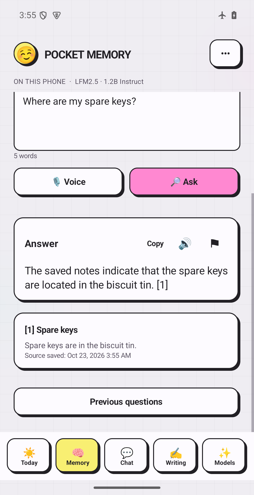

# Pocket Memory
Native Android local AI and personal knowledge application.

## The problem
A saved note is useful only if you can find the original fact again. This project brings capture, retrieval and source inspection into an Android interface, with the core AI work running on the phone.

## Implemented in the development preview
- Local GGUF generation through a native llama.cpp integration.
- SQLite originals, note versions, FTS4 keyword retrieval and optional EmbeddingGemma vectors.
- Exact cosine search combined with keyword results using reciprocal rank fusion.
- Up to six retrieved passages, with source note identifiers, dates and numbered citations.
- Explicit missing-information behavior and an extractive fallback for rejected model output.
- Source snapshots for historical answers and user-reviewed links between corrections or unresolved statements.
- Bundled OCR with review before saving, Whisper voice input, offline Android speech output and writing tools.
- Verified resumable model delivery, cancellation, bounded work and password-protected backup export.

## Evidence

The campaign workspace documents actual Android emulator captures using fictional fixtures. Its provenance records say the illustrated local answer was generated with airplane mode enabled. The image is evidence of that example, not a benchmark or a guarantee about future answers.

The source project records Android/native regression and model-download checks. Those historical checks were not rerun to publish this case study.

## Boundaries
Initial model installation requires a connection. Model size is not the same as working RAM. Exact vector scanning needs profiling for larger libraries. Citation and overlap checks cannot establish semantic truth. Direct PDF/Word import, universal contradiction detection, production release readiness and physical-device performance are not claimed.

## Relevant client work
A scoped document or notes assistant with an inspectable source trail; local model integration; Android retrieval UX; or diagnosis of missing evidence and unreliable retrieval. The appropriate document formats, hardware and accuracy checks must be agreed for each engagement.
